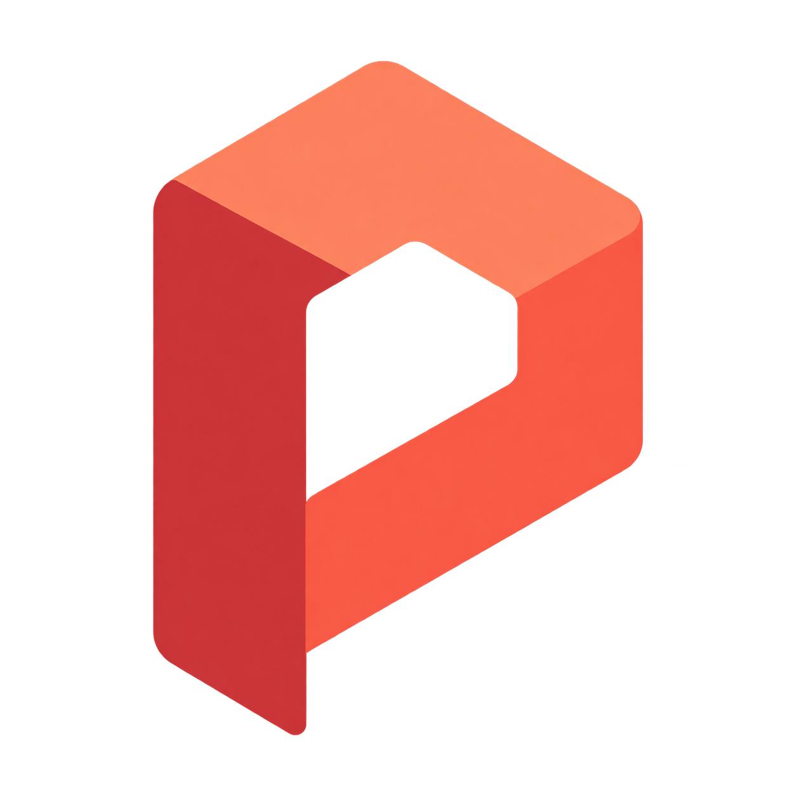

# Prism

[](https://github.com/Toji-ue/Prism/actions/workflows/ci.yml)
[](https://github.com/Toji-ue/Prism/releases)
[](LICENSE)
[](#downloads)

**A drawing studio for Sketch → Ink → Paint.**

An open-source desktop app for building an illustration from the first pencil marks to the final colour. Graphite pencils, ink brushes, layers, a canvas-focused workspace, and automatic timelapse recording — built with C++20 and Qt Quick.

[Download Prism](#downloads) · [Report an issue](https://github.com/Toji-ue/Prism/issues) · [MIT License](LICENSE)

[Features](#features) · [Tools and workflow](#tools-and-workflow) · [File formats](#file-formats) · [Under the hood](#under-the-hood) · [Get started](#get-started) · [Build from source](#build-from-source) · [Contributing](#contributing)

## Features

### Start in graphite. Finish in colour.

Sketch with **HB Pencil** and **2B Pencil**, using canvas-anchored grain, pressure-sensitive marks, and tilt shading. Switch to **Clean Ink** or **Bold Ink** for tapered linework, then build up colour with **Soft Paint**, **Opaque Paint**, and **Airbrush**.

Brush Lab keeps choosing and editing separate. Search your presets, browse pinned or recent brushes, then open **Edit brush** to adjust the tip, flow, pressure response, stabilization, and graphite settings. Preview changes, save a copy, or reset to the stored preset.

### Give the canvas room.

The full workspace keeps Layers on the right and Colour underneath. Light and dark themes share the same controls, with brush size and flow close at hand.

Press **Tab** or use the Focus icon to hide the interface. A small restore button brings it back; **Q** opens quick controls near your cursor. Layers, brushes, and colour remain available through keyboard shortcuts. Every entry into a document starts with the full workspace.

### Build your illustration in layers.

Organize raster layers into nested groups. Use clipping for colour passes, alpha lock to work inside existing marks, and layer opacity or **19 blend modes** to combine them. Undo and redo cover painting and layer changes.

The colour picker combines a hue ring, saturation/value controls, HSV fields, Hex input, and recent colours. Pin it beside Layers or open it when you need it.

### Keep the process with the picture.

Recording runs automatically as you draw. Open **REC** to review captured frames, browse sessions, change capture settings, and export a timelapse. Recording data stays on your machine until you confirm deletion.

Frames are written incrementally to disk. A local timeline can continue across drawing sessions, and **Save As** branches the recording history. Export GIF, a portable `.prismrec` bundle, or MP4 on Windows.

### Save the layers. Keep a recovery copy.

Save your artwork as a layered `.prism` project. Autosave keeps separate recovery snapshots, and the Start Page offers available artwork and recording recovery sessions. An autosave does not mark your project as explicitly saved.

Create a blank document or start from the clipboard, set its dimensions and DPI, and choose a transparent or separate background layer. Export a flat PNG when you are ready to share the image.

## Tools and workflow

| Area | Included |
| --- | --- |
| Drawing | Freehand brush, eraser, airbrush, eyedropper, flood fill, lasso fill, gradients |
| Shapes | Lines, rectangles, ellipses, brush-stroked paths |
| Selections | Rectangular and elliptical selections, lasso, polygon, magic wand, select all, invert |
| Layers | Raster layers, nested groups, blend modes, opacity, clipping, alpha lock, locking and reordering |
| Image edits | Crop, canvas resize, layer rotation/scale, invert, desaturate, blur, brightness/contrast |
| Brushes | Search, pinned/recent presets, tip and dynamics editing, preview, Save copy, Reset, import/export |
| Workspace | Light/dark themes, Focus mode, Quick Controls, configurable tool shortcuts, offline help |

### Keyboard essentials

| Shortcut | Action |
| --- | --- |
| `B` / `E` | Brush / Eraser |
| `Ctrl+S` | Save project |
| `Ctrl+Z` / `Ctrl+Shift+Z` | Undo / Redo |
| `Tab` | Toggle Focus mode from canvas focus |
| `Q` | Open Quick Controls |
| `Ctrl+1` / `Ctrl+2` / `Ctrl+3` | Layers / Brush Lab / Colour |
| `F1` | Open offline help |

Panel shortcuts respect text input and active strokes. In the full workspace, Layers stays docked; Focus mode opens it in the shared popover.

## File formats

| Format | Purpose |
| --- | --- |
| `.prism` | Native layered artwork, including groups and layer properties; v2 reads earlier v1 projects |
| `.prismbrush` | Brush presets; v5 keeps support for v1–v4 imports |
| `.prismrec` | Drawing recordings and portable multi-session bundles; v1/v2/v3 support |
| PNG | Flat image export with transparency and DPI metadata |
| Image import | PNG, JPEG, TIFF, WebP, and other formats provided by the installed Qt image plugins |
| GIF / MP4 | Timelapse video export; MP4 currently requires Windows |

Documents currently use **RGB/Alpha, 8-bit, sRGB**. TIFF support is included; JBIG-compressed TIFF is unsupported. Paint does not currently simulate wet pigment mixing.

## Under the hood

- **Native desktop UI:** C++20 with Qt 6 and QML, built through CMake presets.
- **Shared brush pipeline:** live strokes, committed painting, preset previews, and replay use the same stamp-placement path.
- **Incremental rendering:** CPU brush/compositing code feeds the Qt Quick scene graph, with dirty-region updates and 256 px texture tiles.
- **Reversible edits:** a command/history system records pixel and layer changes.
- **Disk-backed recording:** bounded capture queues and background I/O handle recording and export.
- **Testable modules:** core math and domain logic are separate from the UI; GoogleTest and Qt Test cover pixels, formats, history, recording, and interactions.

See the [source tree](src), [tests](tests), and [CI workflow](.github/workflows/ci.yml) for the implementation.

## Get started

1. [Install Prism](#downloads) for your operating system.
2. Choose **New Document** or **Open** on the Start Page.
3. Pick a brush in **Brush Lab**, choose a colour, and draw on the selected layer.
4. Save as `.prism` to retain your layers, or export PNG for a flat image.
5. Open **REC** to review or export your timelapse. Press **F1** for the drawing guide.

## Build from source

You need a C++20 compiler, CMake 3.24+, Ninja, Qt Quick/Test/Network with image-format plugins, and GoogleTest. Release CI uses **Qt 6.11.1**. CMake declares a Qt 6.4 minimum; that minimum is not a separately verified release configuration.

Put the compiler and Qt tools on `PATH`, then:

```sh
git clone https://github.com/Toji-ue/Prism.git
cd Prism
cmake --preset release
cmake --build --preset release
ctest --test-dir build-release --output-on-failure
```

On Windows, use **MSYS2 UCRT64**, including Qt base/declarative, GoogleTest, and `mingw-w64-ucrt-x86_64-qt6-imageformats` for TIFF and WebP support. The [CI workflow](.github/workflows/ci.yml) lists the platform-specific build dependencies.

For a debug build, use the `default` configure/build/test presets. Maintainers use `tools/deploy.ps1` and `tools/package.ps1` for Windows; macOS/Linux staging uses the `native-release` preset and `tools/package-native.py`. Packaging checks the runtime, notices, corresponding sources, and artifact hashes.

## Downloads

**Current release: [0.3.0-beta.1](https://github.com/Toji-ue/Prism/releases/tag/v0.3.0-beta.1) — prerelease.**

| Platform | Installer | Requirements |
| --- | --- | --- |
| Windows | [Download Setup (.exe)](https://github.com/Toji-ue/Prism/releases/download/v0.3.0-beta.1/Prism-0.3.0-beta.1-8deb20e0cc47-2afe57ce7296-Setup.exe) | Windows 10/11, x64 |
| macOS | [Download disk image (.dmg)](https://github.com/Toji-ue/Prism/releases/download/v0.3.0-beta.1/Prism-0.3.0-beta.1-macos-arm64-93e470551b08.dmg) | macOS 14+, Apple Silicon; no Intel build |
| Ubuntu | [Download package (.deb)](https://github.com/Toji-ue/Prism/releases/download/v0.3.0-beta.1/Prism-0.3.0-beta.1-linux-x86_64-0ce08f79aa5a.deb) | Ubuntu 24.04 desktop, amd64/x86_64 |

Verify downloads with [**SHA256SUMS.txt**](https://github.com/Toji-ue/Prism/releases/download/v0.3.0-beta.1/SHA256SUMS.txt).

### Windows

Run Setup and follow the installer. The build does not have a verified publisher signature.

### macOS

Open the DMG and copy **Prism.app together with THIRD-PARTY** to a writable application folder, such as `~/Applications/Prism/`.

The app has an ad-hoc signature and is not Apple Developer ID signed or notarized. macOS may block first launch; follow your organization's security policy without disabling Gatekeeper globally.

### Ubuntu

Download the DEB, open a terminal in its folder, and install with APT:

```sh
sudo apt install ./Prism-0.3.0-beta.1-linux-x86_64-*.deb
```

Launch **Prism** from the application menu or run `prism`. To remove the application, run `sudo apt remove prism`; artwork and user recordings are preserved. Other distributions and older glibc versions have not been validated.

The same SHA-256 values are included in the release notes. GitHub's automatic source-code archives are for building from source.

## Contributing

Bug reports, fixes, and workflow feedback are welcome through [issues](https://github.com/Toji-ue/Prism/issues) and [pull requests](https://github.com/Toji-ue/Prism/pulls).

Include your OS, Prism version, reproduction steps, and a screenshot when useful. For pen-input issues, include the tablet model and driver. The installed `candidate-manifest.json` identifies the build; leave private artwork and recordings out of reports unless you intend to share them.

Before submitting a change, read [AGENTS.md](AGENTS.md), run the relevant tests, and include screenshots for UI changes. Distinguish real tablet testing from simulated input. Project documentation and release notes are written in English.

## License

Prism's original code and documentation are available under the **[MIT License](LICENSE)**.

Third-party components retain their own licenses. Release packages include their notices, corresponding sources, and instructions for replacing LGPL libraries. See [dependency provenance](third_party/README.md) and the [native runtime review](third_party/native-release-license-review.md) for details.
